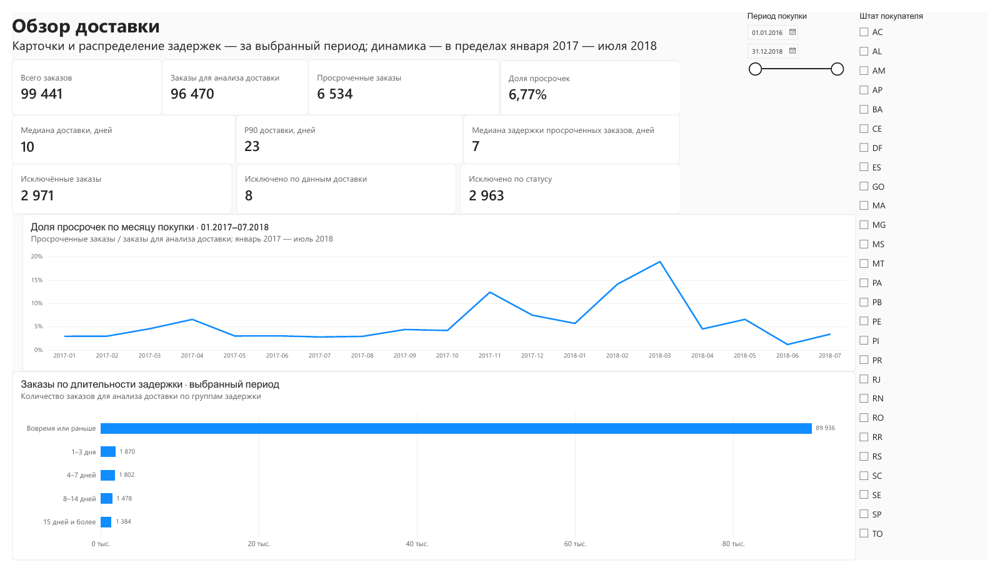

# Анализ задержек доставки Olist

Учебный аналитический проект: где сосредоточены просроченные доставки, как задержки связаны с оценками покупателей и какие направления стоит исследовать в первую очередь.

## Результаты

- Из 96 470 пригодных заказов просрочены 6 534 — **6,77%**. Медиана доставки — 10 дней, P90 — 23 дня; медианная задержка просроченных — 7 дней.
- Штаты покупателей **SP и RJ дают 3 315 просрочек, или 50,73%** всех просрочек. Это приоритет для разбора, не доказательство ответственности участников доставки.
- Доля оценок 1–2 составляет **19,44% при опоздании против 9,25% вовремя**. Покрытие пригодными отзывами сильно отличается: 29,20% против 99,25%; причинный эффект не установлен.

## Предлагаемые действия

Начать разбор со штатов SP/RJ, исследовать этап от передачи перевозчику до вручения, проверить сбор отзывов после доставки. Наблюдения, гипотезы, предлагаемые исполнители и способы проверки: [таблица приоритетов](reports/action_priorities.md). Условный сценарий снижения просрочек SP/RJ на 10% означает 332 предотвращённые просрочки и общую долю 6,43%; это расчёт при заданном допущении, не прогноз. [Формулы и ограничения сценариев](reports/scenario_analysis.md).

## Статус и материалы

Подготовлены raw/staging/mart, анализ доставки и отзывов, три страницы Power BI и согласованный бизнес-отчёт. Полная сборка SQL проверена в новой базе PostgreSQL 18: **28 OK, 0 FAIL**. [SQL и порядок запуска](sql/README.md), [дашборд Power BI](dashboard/olist_delivery_analysis.pbix), [PDF-превью](dashboard/olist_delivery_analysis_preview.pdf), [бизнес-отчёт](reports/olist_business_report.pdf).

Фильтр периода и показатели исключений в Power BI сверены на полном периоде и марте 2018 года. Исторический сценарный ориентир проверен SQL и включён в бизнес-отчёт. 25 ноября 2026 года сохранён актуальный PBIX, обновлены и визуально проверены четыре страницы PDF/PNG-превью; подробности — в [проверке комплекта по ТЗ](reports/final_audit.md).

[Качество данных](reports/data_quality.md), [словарь метрик](reports/metric_dictionary.md), [доставка](reports/delivery_overview.md), [география](reports/geography_analysis.md), [продавцы](reports/seller_analysis.md), [категории](reports/category_analysis.md), [этапы](reports/stage_analysis.md), [отзывы](reports/reviews_analysis.md).

## Инструменты

- PostgreSQL — хранение данных, преобразования и аналитические SQL-запросы.
- pgAdmin — работа с базой данных.
- Power BI Desktop — отчёт с импортом данных из PostgreSQL.
- GitHub — код, документация и результаты.

## Структура проекта

Итоговый бизнес-отчёт: [PDF](reports/olist_business_report.pdf) и [редактируемый Word](reports/olist_business_report.docx). Согласованная версия содержит основные результаты, три рекомендации, исторический ориентир по долям просрочек 2017 года, дополнительные условные сценарии 5/10/20%, методику и ограничения анализа.

Проверенный статический обзор дашборда: [PDF на четыре страницы](dashboard/olist_delivery_analysis_preview.pdf). Вторая страница Power BI представлена двумя вариантами: категории и продавцы. PDF показывает видимые строки рейтингов и общие итоги; полные интерактивные таблицы доступны в файле Power BI.

- `data/` — инструкция получения данных; исходные CSV не включаются в Git.
- `sql/` — SQL-скрипты загрузки, проверок, преобразований и анализа.
- `dashboard/` — файл Power BI, формулы DAX, описание проверок и каталог скриншотов.
- `reports/` — документация метрик, отчёт о качестве и итоговые выводы.

## План работы

1. Подготовить окружение и репозиторий.
2. Получить данные, описать источник и загрузить слой `raw`.
3. Проверить качество данных и зафиксировать правила обработки.
4. Создать слои `staging` и `mart`, проверить метрики.
5. Проанализировать доставку, сегменты и отзывы.
6. Создать дашборд и сверить его с SQL.
7. Подготовить три рекомендации и итоговую документацию.

## Основные правила анализа

- Просрочка: календарная дата фактической доставки позже обещанной календарной даты.
- Основная витрина содержит одну строку на заказ; соединения не должны увеличивать число заказов без объяснения.
- Медианная задержка рассчитывается только среди просроченных заказов.
- Для каждой метрики фиксируются выборка, знаменатель и причины исключений.
- Основной анализ продавцов использует заказы с одним продавцом, категорий — с одной категорией; покрытие показывается отдельно.

## Источник и ограничения

Источник по ТЗ: Brazilian E-Commerce Public Dataset by Olist. Порядок получения и статус данных: [data/README.md](data/README.md).

Автор данных — Olist, источник — [Kaggle](https://www.kaggle.com/datasets/olistbr/brazilian-ecommerce), лицензия данных — [CC BY-NC-SA 4.0](https://creativecommons.org/licenses/by-nc-sa/4.0/). Исходные CSV не включены в Git; локальная копия идентифицирована SHA-256 в [манифесте](data/source_manifest.csv). Преобразования и ограничения версии описаны в data/README.md.

Данные исторические. Дата доставки относится к заказу целиком и не устанавливает виновника задержки. Связь задержек с оценками не доказывает причинность. Рекомендации не означают достигнутого улучшения или измеренной экономии.

## Воспроизведение

Полная последовательная сборка SQL 01–08 проверена 25 ноября 2026 года в новой базе PostgreSQL 18: **28 контрольных проверок OK, 0 FAIL**. [Результаты проверки воспроизводимости](reports/rebuild_validation.md).

Создание схем и исходных таблиц: [sql/01_create_raw.sql](sql/01_create_raw.sql). Импорт через psql: [sql/02_load_data.sql](sql/02_load_data.sql). Проверки: [sql/03_quality_checks.sql](sql/03_quality_checks.sql). Подготовка данных: [sql/04_staging.sql](sql/04_staging.sql). Витрины: [sql/05_marts.sql](sql/05_marts.sql). Анализ доставки: [sql/06_delivery_analysis.sql](sql/06_delivery_analysis.sql). Анализ отзывов описан в [sql/07_reviews_analysis.sql](sql/07_reviews_analysis.sql). Скрипт импорта проверен пользователем в отдельной тестовой базе: количества строк совпали, повторный импорт заблокирован. Порядок запуска и проверки: [sql/README.md](sql/README.md).
